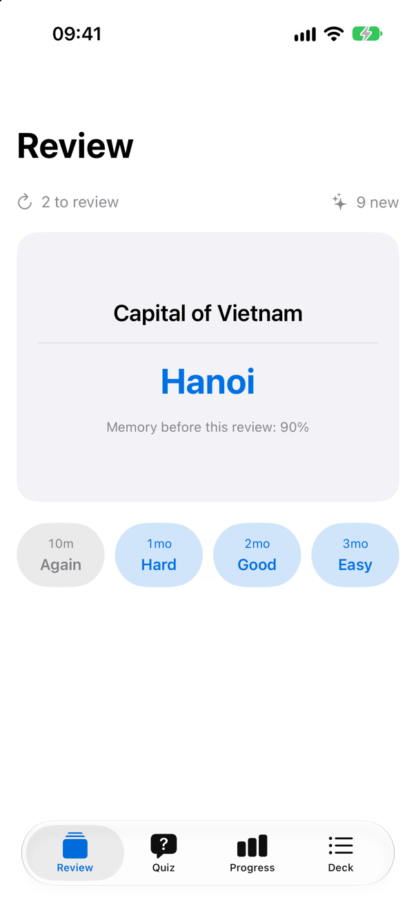
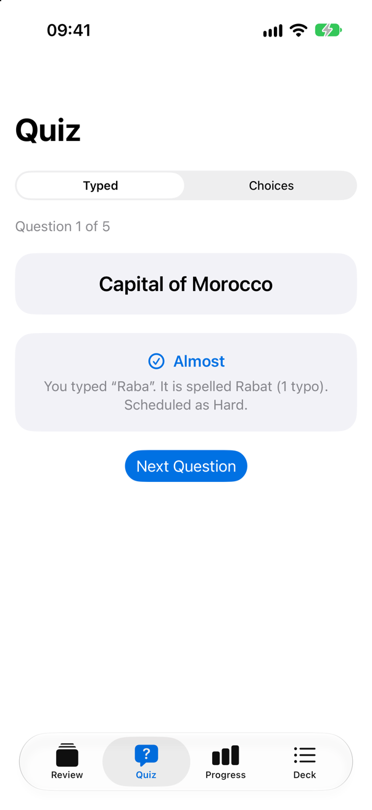
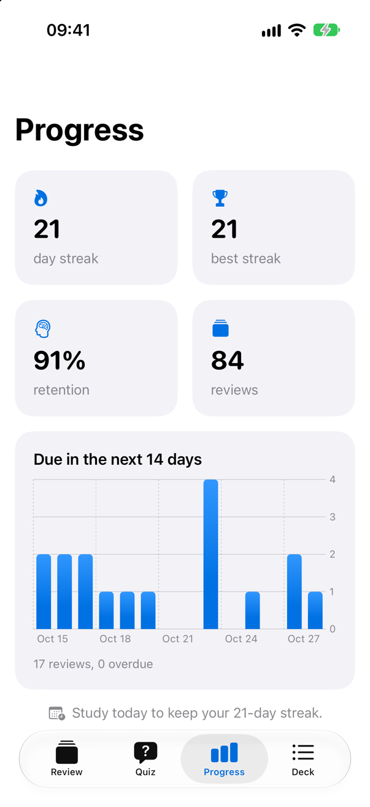
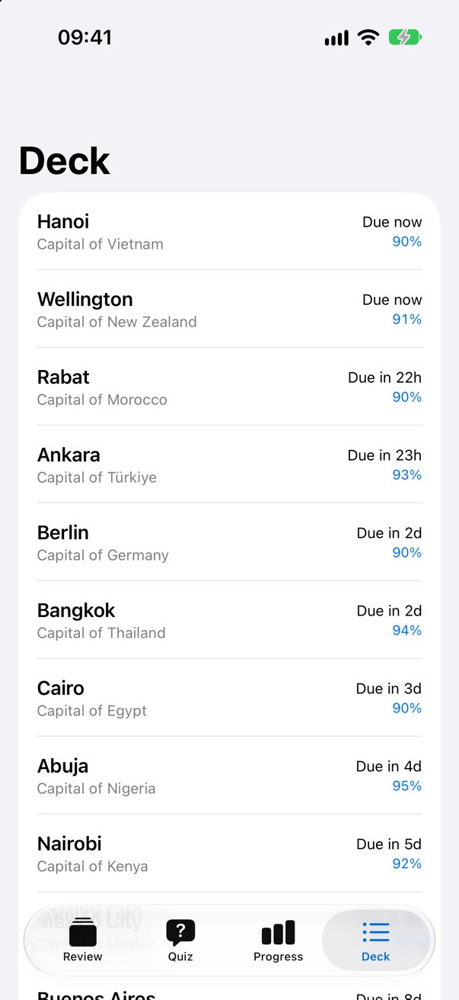

<!-- i18n-source: README.md@f9244ae8b5ee36d676748f903909a5d507c7a923 status=reviewed -->
<!-- brand:start -->

<p align="center"><picture><source media="(prefers-color-scheme: dark)" srcset="https://raw.githubusercontent.com/muhittincamdali/educationai/main/.github/brand/banner-fr-dark.svg"><source media="(prefers-color-scheme: light)" srcset="https://raw.githubusercontent.com/muhittincamdali/educationai/main/.github/brand/banner-fr-light.svg"></picture></p>

<!-- lang-selector:start -->
<p align="center"><a href="README.md">English</a> · <a href="README.tr.md">Türkçe</a> · <a href="README.zh-CN.md">简体中文</a> · <a href="README.ja.md">日本語</a> · <a href="README.ko.md">한국어</a> · <a href="README.es.md">Español</a> · <a href="README.de.md">Deutsch</a> · <a href="README.fr.md">Français</a> · <a href="README.pt-BR.md">Português (Brasil)</a> · <a href="README.ru.md">Русский</a></p>
<!-- lang-selector:end -->

<p align="center">
<a href="https://github.com/muhittincamdali/educationai/actions/workflows/ci.yml"></a>
<a href="https://github.com/muhittincamdali/educationai/releases"><picture><source media="(prefers-color-scheme: dark)" srcset="https://raw.githubusercontent.com/muhittincamdali/educationai/main/.github/brand/badge-version-dark.svg"><source media="(prefers-color-scheme: light)" srcset="https://raw.githubusercontent.com/muhittincamdali/educationai/main/.github/brand/badge-version-light.svg"></picture></a>
<a href="https://github.com/muhittincamdali/educationai/blob/main/Package.swift"><picture><source media="(prefers-color-scheme: dark)" srcset="https://raw.githubusercontent.com/muhittincamdali/educationai/main/.github/brand/badge-platforms-dark.svg"><source media="(prefers-color-scheme: light)" srcset="https://raw.githubusercontent.com/muhittincamdali/educationai/main/.github/brand/badge-platforms-light.svg"></picture></a>
<a href="https://github.com/muhittincamdali/educationai/blob/main/Package.swift"><picture><source media="(prefers-color-scheme: dark)" srcset="https://raw.githubusercontent.com/muhittincamdali/educationai/main/.github/brand/badge-language-dark.svg"><source media="(prefers-color-scheme: light)" srcset="https://raw.githubusercontent.com/muhittincamdali/educationai/main/.github/brand/badge-language-light.svg"></picture></a>
<a href="https://github.com/muhittincamdali/educationai/blob/main/LICENSE"><picture><source media="(prefers-color-scheme: dark)" srcset="https://raw.githubusercontent.com/muhittincamdali/educationai/main/.github/brand/badge-license-dark.svg"><source media="(prefers-color-scheme: light)" srcset="https://raw.githubusercontent.com/muhittincamdali/educationai/main/.github/brand/badge-license-light.svg"></picture></a>
</p>

<p align="center">
<a href="#démarrage-rapide"><picture><source media="(prefers-color-scheme: dark)" srcset="https://raw.githubusercontent.com/muhittincamdali/educationai/main/.github/brand/button-start-fr-dark.svg"><source media="(prefers-color-scheme: light)" srcset="https://raw.githubusercontent.com/muhittincamdali/educationai/main/.github/brand/button-start-fr-light.svg"></picture></a>
<a href="https://muhittincamdali.github.io/educationai/documentation/educationai/"><picture><source media="(prefers-color-scheme: dark)" srcset="https://raw.githubusercontent.com/muhittincamdali/educationai/main/.github/brand/button-docs-fr-dark.svg"><source media="(prefers-color-scheme: light)" srcset="https://raw.githubusercontent.com/muhittincamdali/educationai/main/.github/brand/button-docs-fr-light.svg"></picture></a>
<a href="https://github.com/muhittincamdali/educationai/tree/main/Examples"><picture><source media="(prefers-color-scheme: dark)" srcset="https://raw.githubusercontent.com/muhittincamdali/educationai/main/.github/brand/button-examples-fr-dark.svg"><source media="(prefers-color-scheme: light)" srcset="https://raw.githubusercontent.com/muhittincamdali/educationai/main/.github/brand/button-examples-fr-light.svg"></picture></a>
</p>

> Ceci est une traduction du README anglais. En cas de différence, la version anglaise fait foi.

<!-- brand:end -->

Un package Swift qui contient la logique d’apprentissage d’une application de cartes mémoire ou de révision. `FSRSScheduler` décide quand chaque carte revient grâce à FSRS-6, le modèle de mémoire sur lequel repose le planificateur FSRS d’Anki, et donne les mêmes résultats que l’implémentation de référence, `py-fsrs` 6.3.2. `SM2Scheduler` garde les données SM-2 utilisables et les convertit en FSRS sans perdre la progression. Autour du planificateur, on trouve une file d’étude, la correction des réponses saisies avec tolérance aux fautes de frappe, des quiz, un ajusteur de difficulté, une prévision de charge de travail, des statistiques de révision et des séries d’étude. Tout s’exécute sur l’appareil, sans aucune dépendance, et est écrit pour la concurrence stricte (strict concurrency) de Swift 6.

<p align="center">
<picture><source media="(prefers-color-scheme: dark)" srcset="docs/images/review-dark.png"></picture>
<picture><source media="(prefers-color-scheme: dark)" srcset="docs/images/quiz-dark.png"></picture>
</p>

## Points forts

- **FSRS-6, vérifié par rapport à la référence** — les tests rejouent 2 400 révisions calculées par `py-fsrs` 6.3.2 avec huit configurations et comparent la stability, la difficulty, la date d’échéance et la retrievability après chaque révision. Les étapes d’apprentissage et de réapprentissage, la rétention souhaitée, l’intervalle maximal, le fuzz des intervalles et les poids personnalisés (21 de FSRS-6 ou 19 de FSRS-5) sont pris en charge.
- **Des valeurs, pas des services** — les planificateurs, les états, les quiz et les ajusteurs sont des types valeur `Sendable` et `Codable`. Chaque fonction reçoit la date avec laquelle elle travaille, et l’aléatoire vient d’un générateur auquel vous pouvez donner un seed, de sorte que les résultats peuvent être testés pour n’importe quel jour.
- **Sûr avec les données enregistrées** — les états relus depuis un fichier ou une base de données sont vérifiés avant utilisation. Les valeurs NaN, infinies ou négatives lèvent une erreur au lieu de planter, les compteurs s’arrêtent à `Int.max` et un quiz enregistré est de nouveau noté au chargement.
- **Des réponses saisies traitées équitablement** — `AnswerMatcher` ignore la casse, les accents, la largeur des caractères et la ponctuation sans dépendre de la langue de l’appareil, tolère les fautes de frappe selon la longueur de la réponse et fait un travail proportionnel à cette longueur, même face à une entrée hostile.
- **Tout ce qui entoure le planificateur** — une file d’étude avec des limites quotidiennes, SM-2 et sa migration vers FSRS, des quiz à choix multiples et à réponse saisie construits à partir des cartes, des indices de réponse, un ajusteur de difficulté, une prévision par jour, des statistiques de rétention et des séries dans le fuseau horaire de l’apprenant.
- **Testé** — 127 tests, exécutés sur macOS et sur un simulateur iOS, y compris les exemples du README.

## Démarrage rapide

**1. Ajouter le paquet**

Dans Xcode, choisissez **File › Add Package Dependencies…** et saisissez l’URL du dépôt :

```text
https://github.com/muhittincamdali/educationai.git
```

Collez-la dans le champ de recherche en haut à droite de la fenêtre. Laissez **Dependency Rule** sur **Up to Next Major Version** à partir de `2.0.0`, puis cliquez sur **Add Package**. Dans la fenêtre suivante, choisissez la cible de votre application à côté de **EducationAI** et cliquez de nouveau sur **Add Package**.

**2. Importer le module**

```swift
import EducationAI
```

Placez cette ligne en haut du fichier Swift où vous afficherez les cartes, sous `import SwiftUI`.

**3. Afficher les cartes et les noter**

Ajoutez cette vue au fichier et affichez-la depuis votre application, par exemple comme contenu de votre `WindowGroup` :

```swift
struct FlashcardsView: View {
    @State private var cards = [
        Flashcard(front: "Capital of Japan", back: "Tokyo"),
        Flashcard(front: "Capital of Kenya", back: "Nairobi"),
        Flashcard(front: "Capital of Peru", back: "Lima")
    ]
    @State private var showsAnswer = false
    private let scheduler = FSRSScheduler.default

    var body: some View {
        if let card = StudyQueue.cards(from: cards).first,
           let index = cards.firstIndex(where: { $0.id == card.id }) {
            VStack(spacing: 24) {
                Text(card.front).font(.title)
                if showsAnswer {
                    Text(card.back).font(.title2).bold()
                    HStack {
                        ForEach(Rating.allCases, id: \.self) { rating in
                            Button(String(describing: rating).capitalized) {
                                if let outcome = try? scheduler.review(card.review, rating: rating) {
                                    cards[index].review = outcome.state
                                }
                                showsAnswer = false
                            }
                            .buttonStyle(.bordered)
                        }
                    }
                } else {
                    Button("Show Answer") { showsAnswer = true }
                        .buttonStyle(.borderedProminent)
                }
            }
            .padding()
        } else {
            Text("All done for now")
        }
    }
}
```

Lancez l’application. Elle affiche **Capital of Japan** ; touchez **Show Answer**, puis **Good**. La carte passe à son étape d’apprentissage de 10 minutes et **Capital of Kenya** apparaît. Quand les trois cartes sont notées, la vue affiche **All done for now**. Ici, les cartes vivent dans `@State` : elles repartent donc de zéro au lancement suivant ; [Enregistrer le paquet](#enregistrer-le-paquet), plus bas, montre comment les conserver.

## Installation

### Swift Package Manager

Dans Xcode, choisissez **File › Add Package Dependencies…** et saisissez l’URL du dépôt :

```text
https://github.com/muhittincamdali/educationai.git
```

Ou ajoutez-le aux `dependencies` de votre `Package.swift` :

```swift
dependencies: [
    .package(url: "https://github.com/muhittincamdali/educationai.git", from: "2.0.0")
],
targets: [
    .target(name: "YourApp", dependencies: [
        .product(name: "EducationAI", package: "educationai")
    ])
]
```

## Utilisation

Les exemples ci-dessous sont copiés de [ReadmeSamples.swift](Examples/StudyDeck/StudyDeck/ReadmeSamples.swift), que l’application d’exemple et la suite de tests compilent et que les tests exécutent.

### Afficher le prochain intervalle sur chaque bouton

Un aperçu donne le résultat des quatre notes. Servez-vous-en pour intituler les boutons, et enregistrez le résultat de celle que touche l’apprenant : c’est le même résultat que celui d’une révision avec cette note.

```swift
func buttonLabels(for card: Flashcard, scheduler: FSRSScheduler) throws -> [String] {
    let preview = try scheduler.preview(card.review)
    let format = Duration.UnitsFormatStyle(allowedUnits: [.days, .hours, .minutes], width: .narrow, maximumUnitCount: 1)
    return Rating.allCases.map { rating in
        let interval = Duration.seconds(preview[rating].interval)
        return "\(String(describing: rating).capitalized) · \(interval.formatted(format))"
    }
}
```

En anglais, cela donne `Again · 1m`, `Hard · 6m` et `Good · 10m` pour une nouvelle carte, et environ une semaine pour `Easy` (le fuzz répartit le jour exact).

### Choisir les réglages

Une rétention plus élevée signifie des intervalles plus courts et davantage de révisions. Les réglages hors limites lèvent une erreur :

```swift
func makeScheduler() throws -> FSRSScheduler {
    try FSRSScheduler(
        desiredRetention: 0.85,
        learningSteps: [60, 600, 3_600],
        relearningSteps: [600],
        maximumInterval: 365
    )
}
```

### Corriger une réponse saisie

```swift
func feedback(for answer: String, card: Flashcard) -> String {
    switch AnswerMatcher().evaluate(answer, acceptedAnswers: card.acceptedAnswers) {
    case .correct: "Correct"
    case .almostCorrect(let expected, _): "Almost: it is spelled \(expected)"
    case .incorrect: "The answer is \(card.back)"
    }
}
```

`"nairobi"` est correct pour `Nairobi`, `"Nairbi"` est presque correct (une faute de frappe), `"Mombasa"` ne l’est pas. Les accents, la casse et la ponctuation sont ignorés : `"Sao Paulo"` correspond à `"São Paulo"`.

### Faire un quiz et planifier d’après les résultats

```swift
func quizAndReschedule(deck: inout [Flashcard], answers: [String: String], at date: Date) throws -> Double {
    var quiz = try QuizSession(questions: QuizBuilder.typedAnswer(from: deck))
    while let question = quiz.currentQuestion {
        let result = try quiz.answer(.text(answers[question.id] ?? ""), to: question.id)
        if let index = deck.firstIndex(where: { $0.id == result.questionID }) {
            deck[index].review = try FSRSScheduler.default.review(deck[index].review, rating: result.suggestedRating, at: date).state
        }
    }
    return quiz.score
}
```

Une mauvaise réponse est planifiée comme **Again**, une réponse avec des fautes de frappe comme **Hard**, une bonne réponse comme **Good**. `QuizBuilder.multipleChoice(from:choiceCount:using:)` crée des questions à choix multiples dont les mauvais choix sont les réponses d’autres cartes.

### Faire passer des données SM-2 à FSRS

```swift
func migrate(easeFactor: Double, intervalDays: Int, due: Date, lastReview: Date) throws -> ReviewState {
    let sm2 = SM2State(easeFactor: easeFactor, repetitions: 4, interval: intervalDays, due: due, lastReview: lastReview)
    return try ReviewState(migrating: sm2, scheduler: .default)
}
```

La carte garde sa date d’échéance, et sa prochaine bonne révision fait croître l’intervalle d’environ son ancien facteur de facilité (easiness factor).

### Afficher la progression

```swift
func progressSummary(deck: [Flashcard], logs: [ReviewLog], now: Date) -> String {
    let streak = StudyStreak(activityDates: logs.map(\.reviewedAt), now: now)
    let forecast = ReviewForecast(dueDates: deck.map(\.review.due), from: now, days: 7)
    let retention = ReviewStatistics(logs: logs).retention ?? 0
    return "\(streak.current)-day streak, \(forecast.days[0].count) due today, "
        + "\(forecast.totalCount) this week, \(Int((retention * 100).rounded())) % retained"
}
```

Chaque révision renvoie un `ReviewLog` en plus du nouvel état (`outcome.log`) ; conservez les journaux pour les statistiques et les séries.

### Enregistrer le paquet

`Flashcard`, `ReviewState`, `ReviewLog`, `FSRSScheduler` et `QuizSession` sont `Codable` : un paquet tient donc dans un fichier JSON, par exemple à `URL.documentsDirectory.appending(path: "deck.json")` :

```swift
func save(_ deck: [Flashcard], to url: URL) throws {
    try JSONEncoder().encode(deck).write(to: url, options: .atomic)
}

func loadDeck(from url: URL) throws -> [Flashcard] {
    try JSONDecoder().decode([Flashcard].self, from: Data(contentsOf: url))
}
```

Un état du fichier qu’aucune révision n’aurait pu produire (NaN, un compteur négatif) fait lever `SchedulingError.invalidState` à sa prochaine révision, au lieu de faire planter l’application.

Pour conserver votre propre modèle, ajoutez-lui une propriété `ReviewState` (c’est une seule valeur `Codable`, elle tient donc dans un attribut SwiftData) et utilisez `StudyQueue.items(from:at:newLimit:reviewLimit:state:)`.

## Démo

<table>
<tr>
<td><picture><source media="(prefers-color-scheme: dark)" srcset="docs/images/progress-dark.png"></picture></td>
<td><picture><source media="(prefers-color-scheme: dark)" srcset="docs/images/deck-dark.png"></picture></td>
</tr>
</table>

Les captures d’écran proviennent de l’[application d’exemple](Examples) sur un simulateur d’iPhone 17 Pro sous iOS 27, prises par [`scripts/capture-screens.sh`](scripts/capture-screens.sh). L’application s’exécute en mode démo avec trois semaines d’étude simulée à partir d’un seed fixe, de sorte que chaque capture montre les mêmes cartes. Pour l’exécuter, ouvrez `Examples/StudyDeck/StudyDeck.xcodeproj`, choisissez un simulateur d’iPhone ou **My Mac**, puis lancez-la.

## Documentation

Référence de l’API et articles :

- [Référence de l’API](https://muhittincamdali.github.io/educationai/documentation/educationai/)
  — chaque type public avec ses paramètres et ses limites.

## Guides

- [Premiers pas](https://muhittincamdali.github.io/educationai/documentation/educationai/gettingstarted)
  — ajouter le package, garder un état de révision par carte, mettre en file, réviser, enregistrer.
- [Planifier les révisions](https://muhittincamdali.github.io/educationai/documentation/educationai/schedulingreviews)
  — comment FSRS fonctionne, les phases d’apprentissage, les réglages et leurs compromis, SM-2 et la migration.
- [Créer des quiz](https://muhittincamdali.github.io/educationai/documentation/educationai/buildingquizzes)
  — des questions à partir des cartes, les sessions de quiz, ce que pardonne la correction des réponses saisies, les indices.
- [Suivre la progression](https://muhittincamdali.github.io/educationai/documentation/educationai/trackingprogress)
  — prévision, statistiques, séries et difficulté adaptative.

## Prérequis

| Plateforme | Version minimale |
| ------------------- | ------------------ |
| iOS | 17 |
| macOS | 14 |
| tvOS | 17 |
| watchOS | 10 |
| visionOS | 1 |
| Chaîne d’outils | Swift 6.2 · Xcode 26+ |

Le package n’utilise que Foundation. L’application d’exemple est destinée à iOS et macOS.

## Architecture

```text
               Flashcard / your model ── ReviewState (Codable)
                          │
StudyQueue ──► what to study now
                          │
FSRSScheduler ──► review / preview ──► ReviewOutcome (new ReviewState + ReviewLog)
SM2Scheduler ───► SM2State ──► ReviewState(migrating:)
                          │
QuizBuilder ──► QuizSession ──► AnswerMatcher / AnswerHint ──► QuizResult.suggestedRating
                          │
ReviewLog[] ──► ReviewStatistics · StudyStreak        due dates ──► ReviewForecast
answers ──► DifficultyAdjuster
```

- `FSRSScheduler` se divise en ses réglages (`FSRSScheduler.swift`), les formules de FSRS-6 écrites pour suivre `py-fsrs` opération par opération (`+Formulas`) et la machine à états avec les vérifications des valeurs enregistrées (`+Transition`).
- Rien ne détient de référence ni de verrou : chaque appel prend des valeurs et renvoie des valeurs, de sorte que les types peuvent être utilisés depuis n’importe quel thread ou actor, et stockés dans SwiftData, Core Data, des fichiers ou iCloud.
- Les limites sont explicites : les réponses de plus de 500 caractères ne sont pas comparées, les prévisions couvrent au plus 3 650 jours, les fenêtres de l’ajusteur contiennent au plus 1 000 réponses, et la construction des quiz tire les mauvais choix avec un nombre fixe de tirages.

## Feuille de route

Prévu, sans ordre précis : entraîner les poids FSRS à partir des journaux de révision d’un apprenant (un optimizer, comme en ont `py-fsrs` et `fsrs-rs`), FSRS-7 une fois que les implémentations de référence l’adopteront pour la planification, l’import des journaux de révision d’Anki et l’équilibrage de la charge des échéances entre les jours. Les suggestions sont les bienvenues dans les [issues](https://github.com/muhittincamdali/educationai/issues).

## Contribuer

Les contributions sont les bienvenues. Lisez le [guide de contribution](https://github.com/muhittincamdali/educationai/blob/main/CONTRIBUTING.md) et le [code de conduite](https://github.com/muhittincamdali/.github/blob/main/CODE_OF_CONDUCT.md) avant d’ouvrir une pull request. Signalez les problèmes de sécurité en privé, comme indiqué dans la [politique de sécurité](https://github.com/muhittincamdali/educationai/blob/main/SECURITY.md).

## Licence

Publié sous licence MIT. Voir [LICENSE](LICENSE).

Design notes: https://muhittincamdali.com/en/open-source/educationai/
